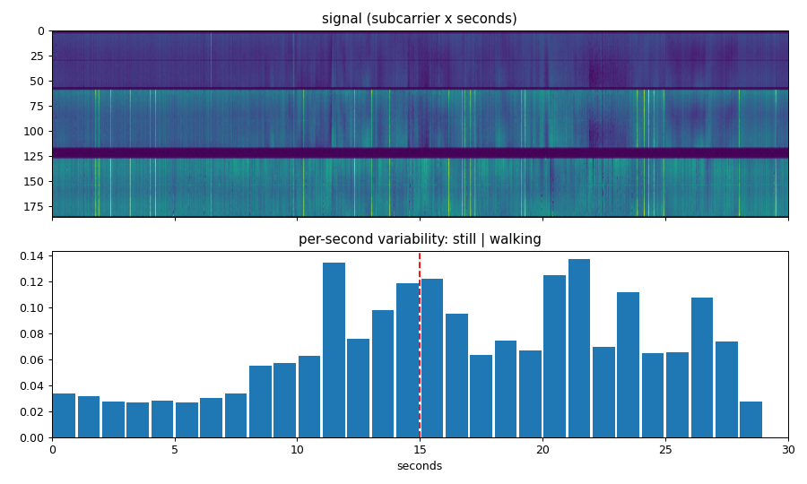
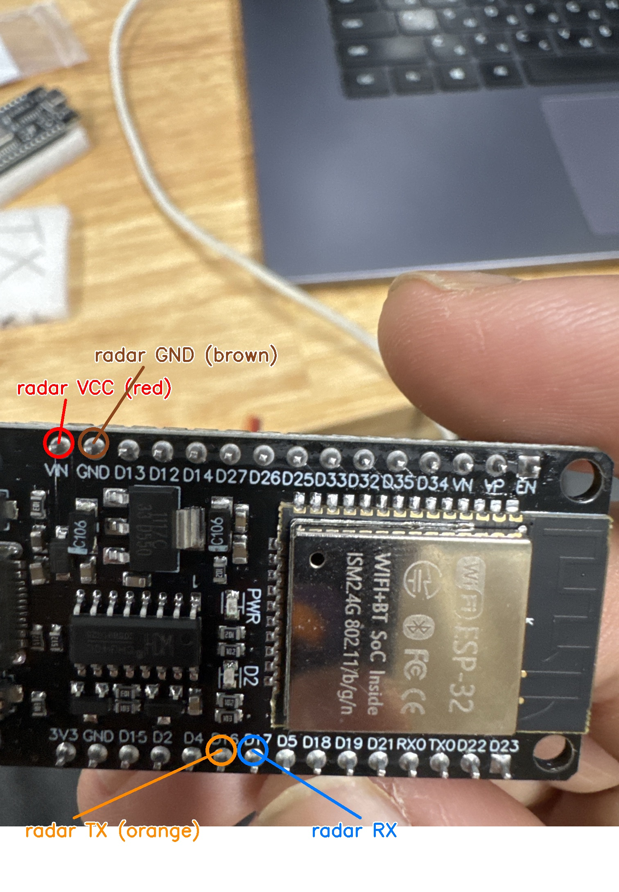

# WiGuard — camera-free fall and inactivity monitoring with WiFi + a $10 radar

Low-cost, open-source monitoring for older people who live alone in small rooms (*jjokbang*, *goshiwon*), where cameras are not acceptable and wearables get taken off. Two ESP32 boards measure how the WiFi signal moves through the room; a 24 GHz mmWave radar confirms whether someone is still there when they stop moving. Everything runs locally: no camera, no cloud, no subscription.

**Hardware cost: about ₩45,000** (3× ESP32 DevKitC ≈ ₩30,000 + LD2410C radar ≈ ₩14,000).

> Status: working prototype. Motion, presence, "left the room" and a "person is not getting up" alarm with a Telegram message work (see [Results](#results) and [Limitations](#limitations)).

## Why

- Lonely deaths (고독사) in Korea keep rising, and older people most often fall in the bathroom — exactly where cameras cannot go.
- Commercial camera-free systems exist (radar products from telecom and care companies), but they cost hundreds of thousands of won plus a subscription.
- WiFi sensing on ESP32 is cheap, but on its own it cannot tell *a person lying still* from *an empty room*. This project combines it with a cheap radar and measures honestly where each sensor works.

## How it works

```
[ESP32 TX] ── WiFi packets, 100/s ──► [ESP32 RX] ──USB──┐
                                                         ├──► laptop (Python) ──► live dashboard + event log
[LD2410C radar] ──UART──► [ESP32 bridge] ──────USB──────┘
```

1. **WiFi CSI (Channel State Information).** The transmitter sends packets on a fixed channel; the receiver reports the amplitude of ~120 subcarriers for every packet (~47 per second over USB). A human body absorbs and reflects 2.4 GHz signals, so the pattern changes when someone moves.
2. **Signal cleaning.** A small share of packets arrive corrupted (1–7 per second with the onboard antennas). A 9-frame median filter removes them before any decision is made.
3. **Two WiFi features:**
   - **Motion** — how much the subcarrier pattern changes from moment to moment (detects walking, sitting down, getting up).
   - **Fingerprint** — how different the current pattern is from a calibrated *empty room*. This keeps information about a person who is *not* moving, which a motion-only pipeline throws away.
4. **Radar.** The LD2410C reports whether a target is moving or still and at what distance (up to ~6 m), including people who are only breathing.
5. **Decisions.** A short empty-room calibration sets the WiFi threshold for each room. The radar (limited to the room's size, `--max-cm`) drives *entered / left the room*. **Alarm:** if the radar sees someone in the room and WiFi sees no movement for `--still` seconds, a countdown starts (audible ticks, cancelled by any movement), then an alert with a siren and a Telegram message to the family.

Why "not getting up" instead of recognising the fall itself: on the public [WiFall](https://huggingface.co/datasets/RS2002/WiFall) dataset (10 people, ESP32-S3), seven classifiers tested on a person they never saw tell a fall from walking or jumping reasonably well (SVM: 91% of falls caught, 19% false alarms), but a fall from **sitting down** poorly (best: logistic regression with amplitude + phase, 84% caught, 35% false alarms). For WiFi both are "the body goes down quickly and stops". What separates them is whether the person moves again afterwards.

## Results

Measured on the prototype in one room (2 boards ~1.5 m apart, HT20, onboard PCB antennas).

| Test | Result |
|---|---|
| Empty room, door closed, 60 s | WiFi motion 0.016–0.029, no false spikes, no packet loss |
| Standing still vs walking near the boards | walking is **2–4× higher** than standing still |
| Recorded session (still / walk / sit / lie phases) | motion: walk 0.038 vs still 0.011–0.019 |
| Fingerprint vs empty room | one session: lying on the floor 10.4 vs empty 4.2; **a second session: floor 3.5, empty 5.3, standing 16–19**. It depends on where the person is, not on posture, so it is not used for decisions |
| Radar presence | detects moving and still people, including a person lying on the floor (still energy 100) |
| Radar in an empty room, factory settings | "still person" 48% of the time (a person ~10 m away behind the wall, plus noise); **0% after limiting the range to 4.5 m** |
| "Left the room" event | reported ~15 s after the person leaves |
| Alarm test (lie down and stay still) | countdown 30 s after the last movement, alert at 45 s, cancelled as soon as the person moved |
| Demo run, 15 + 5 s setting: fall face down, fall backwards, passing out on a chair, collapsing on a desk, fall again | **5 of 5** alarms 20 s after the last movement, 5 of 5 cleared when the person moved; the Telegram message arrived 5–10 s after the alarm |
| Rolling chair pushed into the room | the radar drops a still object after 12–16 s (it does not breathe), before the 20 s alarm |



The fingerprint result comes from **one session** with the reference recorded minutes earlier. It still has to hold up on a different day and at different spots on the floor before it can be trusted.

## Limitations

- **Weak signal.** The onboard PCB antennas give −72 to −82 dBm at 1.5 m. Motion close to the boards is clear; motion in the middle of a 1.5 m link is much weaker. Espressif recommends external antennas.
- **WiFi motion alone cannot see a person lying still** (it looks like an empty room). That is why the radar is there.
- **The moment of the fall is not recognised**, only that the person does not get up. A person resting very still also triggers the countdown, so the `--still` time must be set per home (minutes, not the 30 s demo value).
- **The radar sees through walls.** Its range must be limited to the room, ideally with the radar in the middle of a long wall. With factory settings it also reports "moving" for a person who is only breathing; `radar_gates.py` measures the empty-room noise per 0.75 m gate and can raise the thresholds.
- **Sensitivity beyond the room.** With the door open, movement outside the room is picked up. Boards should be placed away from doors and shared walls.
- One room, one person. Not tested with pets, several occupants or a running shower yet.
- **Fall detection is not validated yet**, and this is not a medical device.

## Hardware

| Part | Qty | Role |
|---|---|---|
| ESP32 DevKitC (classic ESP32, USB-C) | 3 | transmitter, receiver, radar bridge |
| HLK-LD2410C 24 GHz radar | 1 | still/moving presence |
| Female–female jumper wires | 4 | radar → bridge board |
| USB data cables + phone charger | | receiver and bridge to the laptop, transmitter on a charger |

Radar wiring (bridge board): `VCC → VIN`, `GND → GND`, `TX → D16`, `RX → D17`, `OUT` unused.



## Setup

1. Install [ESP-IDF](https://docs.espressif.com/projects/esp-idf/) (tested with v5.5) and clone [espressif/esp-csi](https://github.com/espressif/esp-csi).
2. Switch the examples to 20 MHz (HT20): `git -C esp-csi apply ../firmware/esp-csi-ht20.patch`. HT20 gave a cleaner signal and more frames per second than HT40 on these boards.
3. Flash the boards (`COMx` is the board's port):
   ```
   cd esp-csi/examples/get-started/csi_send   && idf.py set-target esp32 && idf.py -p COMx flash
   cd esp-csi/examples/get-started/csi_recv   && idf.py set-target esp32 && idf.py -p COMy flash
   cd firmware/radar_bridge                   && idf.py set-target esp32 && idf.py -p COMz flash
   ```
4. Python side: `pip install -r requirements.txt`
5. Optional Telegram alerts: create a bot with @BotFather, press **Start** in it from every phone that should get alerts, and save `telegram.json` next to `dashboard.py` (it is git-ignored):
   ```
   {"token": "<bot token>", "chat_ids": []}
   ```
   With an empty `chat_ids` the dashboard sends to everyone who pressed Start.
6. Run the dashboard and open http://localhost:8000 (Korean + English interface):
   ```
   python dashboard.py --csi COMy --radar COMz --max-cm 450 --still 15 --countdown 5
   ```
   Press **Calibrate empty room** and leave the room for 20 seconds. `--max-cm` = how far the room reaches from the radar, `--still` = seconds without movement before the countdown, `--countdown` = seconds of warning ticks before the alert. 15 + 5 s is a demo setting; a real home needs minutes.

## Files

| File | What it does |
|---|---|
| `dashboard.py`, `dashboard.html` | live web dashboard (Korean + English): WiFi motion, fingerprint, radar energy, entered/left events, "not getting up" alarm with sound and Telegram message; saves everything to `data/live/` |
| `csi.py` | reads esp-csi CSV logs, computes amplitudes and the motion measure |
| `radar.py` | parses LD2410C report frames |
| `radar_gates.py` | empty-room radar calibration: noise per distance gate, optional new thresholds |
| `record.py` | records raw CSI to CSV with start/stop beeps |
| `session.py` | records CSI and webcam video together with timed phases, or video only next to the dashboard (used only to label test data, never in deployment) |
| `live.py` | simple live motion plot with empty-room calibration |
| `camera_preview.py` | webcam preview for placing the labelling camera |
| `firmware/radar_bridge` | ESP-IDF firmware that forwards the radar's UART to USB and back (for config commands) |
| `firmware/esp-csi-ht20.patch` | switches the esp-csi examples from HT40 to HT20 |

## Roadmap

- Breathing: in 2 of 3 tests the radar echo behind a person lying still dropped about 3× while they held their breath; it failed when the person lay farther away, so it is not used yet.
- Rest zones (bed, chair, toilet seat) with a longer timer, to cut false alarms from people resting.
- Record falls, sitting down and walking in our own room with the camera; report missed falls, false alarms per hour and time to alert.
- Use a classifier (amplitude + phase) as a hint that shortens the countdown after a likely fall.
- Run on the ESP32 or a Raspberry Pi instead of a laptop.

## Related work

- [espressif/esp-csi](https://github.com/espressif/esp-csi) — firmware base for CSI capture.
- Research on WiFi fall detection (WiFall, ToiFall, WiBFall) reports very high accuracy in laboratory conditions on research WiFi cards; open ESP32 projects report much lower specificity on held-out data, which is why this project measures on separate sessions and adds a second sensor.
- Commercial camera-free monitors use mmWave radar (for example 60 GHz devices in public toilets and care homes) at a much higher price.

## License

MIT
